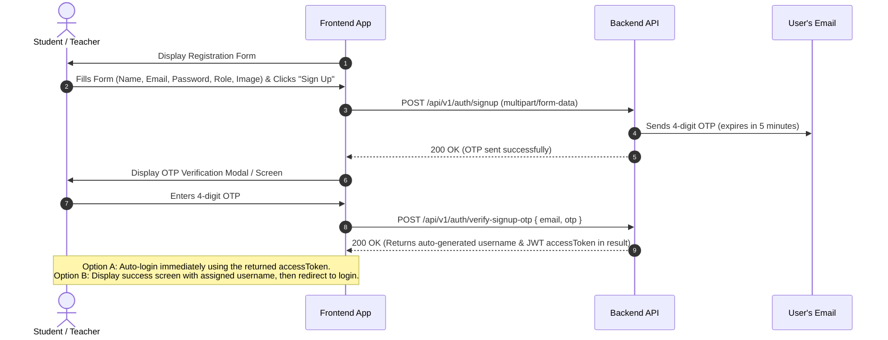

# Manual User Signup (Apple Submission Guide)

This document provides complete instructions for the frontend team to integrate the **Manual Student & Teacher Signup Flow** built specifically for Apple App Store Review compliance.

---

## 📌 Standard API Response Pattern

All successful responses in this backend strictly follow this consistent format:
```json
{
  "success": true,
  "message": "Human readable success message",
  "meta": null,
  "result": {
    /* response payload here */
  }
}
```
And error responses follow:
```json
{
  "success": false,
  "message": "Error description",
  "errorMessages": [
    {
      "path": "fieldName",
      "message": "Detailed error reason"
    }
  ]
}
```

---

## 📌 Architecture & Design Highlights

* **Target Users:** Both **Students** and **Teachers** can sign up.
* **Temporary Staging:** Registrations are saved in a temporary `pending_users` table until the 4-digit OTP is verified. Once verified, the account is moved to `users` with `isManualSignup: true`.
* **Password:** Passwords remain plain-text (unhashed) to align with existing system authentication.
* **Auto-generated Username:** The frontend does **not** generate or provide a username. The backend automatically creates a unique `loginUserName`:
  * **Students:** `s` + 5 random digits (e.g., `s48291`)
  * **Teachers:** `teach` + 5 random digits (e.g., `teach59102`)
  * This is returned in `result.userName` upon successful OTP verification.
* **Login Flexibility:** Users can log in with **either** their auto-generated `userName` **or** their `email` using the standard `POST /api/v1/auth/login`.

---

## 🔄 User Journey & UI Flow



---

## 📡 API Endpoints Specification

### Base URLs
- **Production:** `https://api.darelchimalapp.com/api/v1`
- **Development:** `http://10.0.20.221:5555/api/v1` (or local port)

---

### Step 1: Submit Registration Details & Send OTP

Initiates registration, uploads profile image to DigitalOcean Spaces, saves pending registration, and emails a 4-digit OTP.

* **Method:** `POST`
* **Endpoint:** `/auth/signup`
* **Content-Type:** `multipart/form-data` (or `application/json` if no image file is uploaded)

#### Request Fields:

| Field Name | Type | Required | Description | Example |
| :--- | :--- | :--- | :--- | :--- |
| `email` | String | **Yes** | Valid email address | `"reviewer@apple.com"` |
| `password` | String | **Yes** | User password | `"reviewPass123"` |
| `role` | String | No | Role: `"Student"` or `"Teacher"` (Default: `"Student"`) | `"Student"` |
| `fullName` | String | No | Full display name | `"John Doe"` |
| `gender` | String | No | `"Male"` or `"Female"` | `"Male"` |
| `phone` | String | No | Phone number | `"+96170123456"` |
| `DOB` | String | No | Date of birth (ISO 8601 string) | `"2000-01-15"` |
| `profileImage` | File (Binary) | No | Avatar/photo (JPEG, PNG, WEBP) | `avatar.png` |

#### Request Example (JSON - without profile image):
```json
{
  "fullName": "Jane Student",
  "email": "jane.student@example.com",
  "password": "MySecretPassword123",
  "role": "Student",
  "gender": "Female",
  "phone": "+96170112233",
  "DOB": "2005-06-20"
}
```

#### Request Example (Multipart Form-Data - JavaScript / React):
```javascript
const formData = new FormData();
formData.append("fullName", "Jane Student");
formData.append("email", "jane.student@example.com");
formData.append("password", "MySecretPassword123");
formData.append("role", "Student");
formData.append("gender", "Female");
formData.append("phone", "+96170112233");
formData.append("DOB", "2005-06-20");

if (imageFile) {
  formData.append("profileImage", imageFile);
}

const response = await fetch("https://api.darelchimalapp.com/api/v1/auth/signup", {
  method: "POST",
  body: formData,
});
const data = await response.json();
```

#### Success Response (`200 OK`):
```json
{
  "success": true,
  "message": "OTP sent to your email. Please verify to complete registration.",
  "meta": null,
  "result": {
    "email": "jane.student@example.com"
  }
}
```

#### Error Responses:
* **`400 Bad Request`:**
  ```json
  {
    "success": false,
    "message": "Email is required",
    "errorMessages": [
      {
        "path": "",
        "message": "Email is required"
      }
    ]
  }
  ```
* **`409 Conflict` (Email Already Registered):**
  ```json
  {
    "success": false,
    "message": "User with this email already exists",
    "errorMessages": [
      {
        "path": "",
        "message": "User with this email already exists"
      }
    ]
  }
  ```

---

### Step 2: Verify OTP & Activate Account

Validates the OTP code, auto-generates the unique username, creates the permanent active account, deletes pending registration, and returns user credentials.

* **Method:** `POST`
* **Endpoint:** `/auth/verify-signup-otp`
* **Content-Type:** `application/json`

#### Request Body:
```json
{
  "email": "jane.student@example.com",
  "otp": "4819"
}
```

#### Success Response (`200 OK`):
```json
{
  "success": true,
  "message": "User verified and registered successfully.",
  "meta": null,
  "result": {
    "userName": "s48291",
    "email": "jane.student@example.com",
    "fullName": "Jane Student",
    "role": "Student",
    "accessToken": "eyJhbGciOiJIUzI1NiIsInR5cCI6IkpXVCJ9..."
  }
}
```

> 💡 **Frontend Recommendation:**
> 1. Store `result.accessToken` in your auth store to log the user in directly.
> 2. Show `result.userName` (e.g. `s48291`) on the confirmation screen so the user knows their login username.

#### Error Responses:
* **`400 Bad Request`:**
  ```json
  {
    "success": false,
    "message": "No pending registration found for this email.",
    "errorMessages": [
      {
        "path": "",
        "message": "No pending registration found for this email."
      }
    ]
  }
  ```
* **`401 Unauthorized` (Wrong OTP):**
  ```json
  {
    "success": false,
    "message": "Invalid OTP.",
    "errorMessages": [
      {
        "path": "",
        "message": "Invalid OTP."
      }
    ]
  }
  ```
* **`410 Gone` (OTP Expired):**
  ```json
  {
    "success": false,
    "message": "OTP has expired. Please sign up again.",
    "errorMessages": [
      {
        "path": "",
        "message": "OTP has expired. Please sign up again."
      }
    ]
  }
  ```

---

### Step 3: Subsequent User Login

Users can log in using either their auto-generated `userName` or their `email`.

* **Method:** `POST`
* **Endpoint:** `/auth/login`
* **Content-Type:** `application/json`

#### Request Body (Option A - With Auto-generated Username):
```json
{
  "userName": "s48291",
  "password": "MySecretPassword123",
  "fcmToken": "optional_fcm_token"
}
```

#### Request Body (Option B - With Email directly):
```json
{
  "userName": "jane.student@example.com",
  "password": "MySecretPassword123",
  "fcmToken": "optional_fcm_token"
}
```

#### Success Response (`200 OK`):
```json
{
  "success": true,
  "message": "User successfully logged in",
  "meta": null,
  "result": {
    "accessToken": "eyJhbGciOiJIUzI1NiIsInR5cCI6IkpXVCJ9...",
    "id": "66f123456789abcdef012345",
    "role": "Student",
    "gradeId": null
  }
}
```

---

### Step 4: Admin Cleanup (Post Apple Review)

Wipes all manual/test signups once Apple approves the app.

* **Method:** `DELETE`
* **Endpoint:** `/user/manual-signups`
* **Headers:**
  ```
  Authorization: <ADMIN_JWT_TOKEN>
  ```

#### Success Response (`200 OK`):
```json
{
  "success": true,
  "message": "Manual test signups deleted successfully",
  "meta": null,
  "result": {
    "count": 5
  }
}
```

---

## 🎨 Recommended Frontend UX Checklist

- [ ] **Signup Screen:**
  - Role switcher: "Student" (default) or "Teacher".
  - Input fields: Full Name, Email, Password, Confirm Password, Gender, Phone, DOB.
  - Image picker for profile photo (optional).
- [ ] **OTP Verification Screen:**
  - 4-digit numeric code input.
  - 5-minute countdown timer.
  - "Resend OTP" button (re-invokes `POST /auth/signup`).
- [ ] **Post-Verification Screen:**
  - Confirmation message: *"Your account has been created! Your assigned login username is: **s48291** (You can also log in with your email)."*
  - Auto-login or redirect to dashboard with the returned `result.accessToken`.
